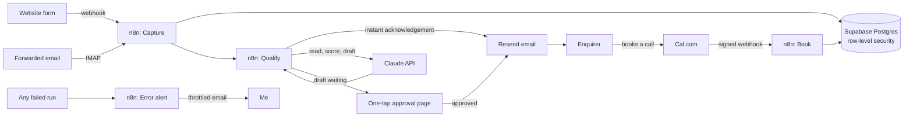

# Studio Hiruko (public sample)

Studio Hiruko ([studiohiruko.com](https://studiohiruko.com)) is a lead-handling system for design studios that I designed and built in November 2026 as a portfolio project. It answers every enquiry within a second, has Claude read and score it, and drafts a reply that a person approves before it goes out.

The real repository is private because it runs a live system. This is a cleaned selection: the database design, the tests that prove clients can't see each other's data, one n8n workflow and a stress-test report. Hostnames, credentials and addresses are replaced with placeholders.

## How it fits together

## Decisions that shaped it

- **One engine, one config record per client.** Adding a studio is a row in `client_config`, never new workflows. Every table carries `client_id`.
- **A person approves before anything AI-written is sent.** The enquirer gets an instant template acknowledgement, so the speed promise holds while the AI reply waits for approval.
- **Clients can read, never write.** Signed-in users get `SELECT` on their own rows only. n8n does all writes with the service role. See [`supabase/migrations`](supabase/migrations).
- **Failures are expected.** Failed sends retry up to three times, ten minutes apart. If Claude is down, the lead is re-scored later, and after three tries the owner gets a "reply yourself" email. Every crash raises an alert, throttled so a broken schedule can't flood the inbox ([`n8n/m0-error-alert.sanitised.json`](n8n/m0-error-alert.sanitised.json)).
- **Guardrails are tested, not assumed.** Draft replies never quote fees, give planning advice or promise dates. Those rules held in all 20 test cases, prompt-injection attempts included.

## Numbers

| What | Result |
| --- | --- |
| Acknowledgement time | 0.55 s median over 200 test enquiries |
| Load test | 200 enquiries in 54 min, 0 failures in 860 n8n runs |
| Tenant isolation | 18 of 18 checks pass ([test](supabase/tests/rls_tenant_isolation.test.sql)) |
| Outage drills | Claude, Resend and Cal.com switched off in turn, no leads lost |
| Size | 19 n8n workflows, 20 SQL migrations, about 340 database tests |

The drills found two real bugs, fixed the same evening. They're written up in [`docs/stress-test-round-2.md`](docs/stress-test-round-2.md).

## Stack

n8n (self-hosted in Docker) · Claude API · Supabase / PostgreSQL with row-level security and pgTAP tests · Resend · Cal.com · Hetzner with Caddy · Python deploy scripts · JavaScript in n8n Code nodes.

I designed the system and wrote the specs, built it with Claude Code as my coding agent, and reviewed, tested and deployed every change myself.

## What I'd add next

Retrieval over each studio's past projects, so replies can point to relevant work, and a proper eval set for the drafts instead of hand-checked test cases.

Juan Ocampo Echeverry · [LinkedIn](https://www.linkedin.com/in/juan-ocampo-echeverry-05a0571b9/)
